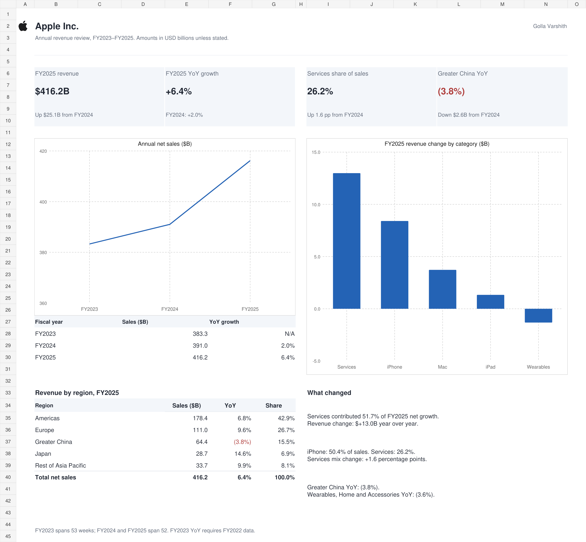

<picture>
  <source media="(prefers-color-scheme: dark)" srcset="assets/apple-logo-white.png">
  
</picture>

# Apple Revenue Analytics

**Python · Google Apps Script · Excel**

A review of Apple's FY2023–FY2025 revenue using reported financial data. The project answers a specific question: **what drove FY2025 growth, and where did sales decline?**

[Open the Excel dashboard](excel/Apple_Financial_Analytics_Dashboard.xlsx) · [Read the analysis](reports/apple_revenue_review.md) · [Run the Python report](#run-the-python-report) · [Set up Google Sheets](docs/google-sheets-setup.md)



## Findings

| Finding | FY2025 result | What it means |
| --- | ---: | --- |
| Total net sales | $416.2B, up 6.4% | Revenue increased by $25.1B over FY2024. |
| Services contribution to growth | $13.0B, or 51.7% of the net increase | Services supplied more than half of the dollar increase in revenue. |
| iPhone share of sales | 50.4% | iPhone remained the largest revenue category. |
| Services share of sales | 26.2%, up 1.6 percentage points | Services grew faster than consolidated revenue. |
| Greater China revenue | Down 3.8% | It was the only reportable region with falling sales. |
| Wearables, Home and Accessories | Down 3.6% | This category offset growth in the other product categories. |

## Skills demonstrated

| Skill | Implementation | Files to inspect |
| --- | --- | --- |
| **Python** | CSV and JSON processing, input validation, independent reconciliation, command-line options, growth calculations, Markdown and CSV report generation, automated tests | [Reporting script](apple_financial_report.py), [tests](tests/test_revenue_report.py) |
| **Google Apps Script** | Custom spreadsheet menu, named-tab input checks, batch writes, native formulas, formatting, conditional rules and chart creation | [Code.gs](apps-script/Code.gs), [setup instructions](docs/google-sheets-setup.md) |
| **Excel** | Linked formulas, revenue mix, growth contribution, `SUM`, `INDEX`/`MATCH`, `RANK`, `COUNTIFS`, `TEXT`, conditional formatting, independent controls and editable native charts | [Workbook](excel/Apple_Financial_Analytics_Dashboard.xlsx) |

## How the analysis works

The product and regional extracts are checked separately against Apple's consolidated revenue for each year. Only reconciled inputs are used to produce the Python report. The Excel workbook contains the same reported values, with calculations visible beside the inputs.

| Metric | Calculation |
| --- | --- |
| Year-over-year growth | Current-year revenue / prior-year revenue − 1 |
| Share of revenue | Category or regional revenue / consolidated revenue |
| Dollar change | FY2025 revenue − FY2024 revenue |
| Contribution to net growth | Category or regional dollar change / consolidated dollar change |
| Services mix change | FY2025 Services share − FY2024 Services share, expressed in percentage points |

Services' 51.7% contribution to growth and 26.2% share of sales use different denominators. A declining category has a negative contribution to net growth. Product and regional tables describe the same sales, so adding the two totals would double-count revenue.

## Run the Python report

Requires **Python 3.9+**. The script uses the standard library; no package installation or credentials are needed.

```bash
git clone https://github.com/varshithyadav17/Apple_Revenue_Analytics.git
cd Apple_Revenue_Analytics
python apple_financial_report.py
```

Validate the source files without writing reports:

```bash
python apple_financial_report.py --check-only
```

Choose another output folder:

```bash
python apple_financial_report.py --output-dir my-reports
```

The script creates [a written revenue review](reports/apple_revenue_review.md) and [a metrics CSV](reports/apple_revenue_metrics.csv). Rates in the CSV are decimals: `0.064` represents 6.4%. Invalid inputs stop the run with a specific error before reports are written.

## Use the Excel workbook

Download the `.xlsx` file and open it in Excel. The workbook has four tabs:

| Tab | Purpose |
| --- | --- |
| EXECUTIVE DASHBOARD | KPIs, annual trend, product growth contribution, regional comparison and findings |
| Product Revenue | Reported category values and supporting calculations |
| Regional Revenue | Reported regional values and changes in regional revenue mix |
| Sources & Notes | Fiscal dates, definitions and independent reconciliation checks |

Reported inputs are blue. Headline results, chart series and quantitative commentary use formulas. The contribution chart sorts by dollar change, including a stable order for ties. Reconciliation differences are highlighted when inputs no longer match the reported controls.

## Use Google Apps Script

Import the two CSVs into a Google spreadsheet as `Product CSV` and `Regional CSV`. Paste [Code.gs](apps-script/Code.gs) into the spreadsheet's Apps Script project, then run `buildAppleRevenueSummary`.

The script validates both input tabs before rebuilding `Automated Summary`. It writes formula-linked annual, product and regional tables, formats the results and adds a sales chart. `@OnlyCurrentDoc` limits its spreadsheet permission to the file where it is installed. The [setup guide](docs/google-sheets-setup.md) includes expected output and troubleshooting.

## Checks

```bash
python -m unittest discover -s tests -v
node tests/apps-script.test.mjs
```

The Python tests cover the reported totals, metric calculations, missing and duplicate categories, invalid amounts, reconciliation failure and report generation. The JavaScript tests check Apps Script input handling, formula references and summary construction using a local spreadsheet stub. They do not replace a run inside Google Sheets.

The Excel workbook was checked for source consistency, formula errors, chart bindings and response to an input change. The Apps Script was also run successfully in a native Google Sheet on **31 October 2026**. The live check covered totals, growth, revenue mix, contribution formulas, chart layout and a repeat run. See the [validation record](docs/validation.md).

## Source and scope

All financial inputs come from [Apple's FY2025 Form 10-K](https://www.sec.gov/Archives/edgar/data/320193/000032019325000079/aapl-20250927.htm): category sales on p. 23, regional sales on p. 22, and consolidated sales on p. 29. Period definitions are on p. 21. [Source metadata](data/apple_sources.json) records the controls and fiscal dates.

The source figures were manually transcribed. Values are USD millions in the inputs and USD billions on the dashboard. FY2023 contains 53 weeks; FY2024 and FY2025 contain 52. FY2023 YoY is unavailable because FY2022 is outside this extract.

This is a historical revenue review. It does not infer customer retention, unit sales or profitability, and it does not adjust for exchange rates or the extra week in FY2023. Data collection and the Excel input update are manual; the scripts automate validation, calculations and report formatting.

The Apple logo identifies the company being analysed. The mark belongs to Apple Inc.; this project is independent and is not affiliated with Apple. The artwork is adapted from [Apple's navigation asset](https://www.apple.com/ac/globalnav/2.0/en_US/images/ac-globalnav/globalnav/apple/image_large.svg).

**Golla Varshith** · [GitHub](https://github.com/varshithyadav17)
